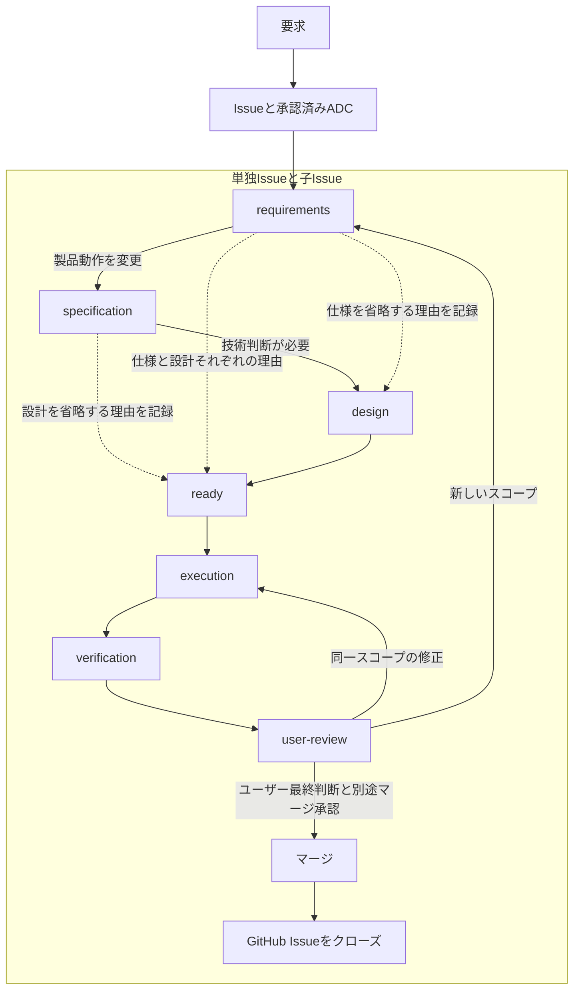

# P-ASES — Puchinya Agentic Software Engineering System

**[English](README.md) | 日本語**

P-ASESは、AIコーディングエージェント向けの**Issue中心のソフトウェア開発ワークフロー**です。要求、製品仕様、技術設計、実装、テスト、レビュー、納品を **Agent Development Contract（ADC）** と検証可能なGitHub証跡で結び付けます。

共通の16 Skills、Markdownの文書標準・テンプレート、Python CLIを提供します。**Codex（OpenAI）、Claude Code、Google Antigravity** 用パッケージは同じ正本から生成します。

> **移行状況：** 子PRのマージやCI成功だけではP-ASESのActivationは完了しません。親[Issue #26](https://github.com/puchinya/ai-agent-workflow/issues/26)には独立したIntegration、User Review、Activationゲートがあります。詳細は[現在の制約](#現在の制約)を参照してください。

## ワークフローの概要

Issueと承認済み**ADC**が、対象範囲・設計判断・検証義務・完了条件を定めます。製品仕様は*何を実現するか*、設計は*どう実現するか*、テスト仕様は*何を期待結果として独立に判定するか*を定め、実装結果と照合します。



点線の矢印は条件付きスキップを表します。製品動作を新規に定義・変更する場合は`specification`が必要で、重要な技術判断を行う場合は`design`が必要です。省略時はそれぞれ独立した理由を記録します。テスト仕様、Oracle、Verification Planは`ready`の前に確定する成果物で、独立したIssue phaseではありません。要求・判断の変更が生じた場合は、依存する後続作業の前に正本へ差し戻します。

| Phase | 役割 |
| --- | --- |
| `requirements` | 対象範囲・要求・受入条件とADCを確定 |
| `specification` | 必要な場合に`docs/specs/`で外部動作を確定 |
| `design` | 必要な場合に`docs/design/`で構成・所有権・失敗処理・互換性を確定 |
| `ready` | 技術判断と独立したテスト・検証条件を準備完了 |
| `execution` | Issue単位のブランチで実装・テスト後、commit・push・PR作成 |
| `verification` | 現行PR HEADのテスト、受入、CI、自己・独立レビュー、Review Readinessを検証 |
| `user-review` | ユーザー最終レビュー、同じIssue/PRで修正に対応 |
| `closed` | 明示許可されたマージ後にGitHub Issueが実際にクローズ。`phase:closed`ラベルは付けない |

親Issueは別フローです：`requirements → ready → execution → integration → user-review → closed`。親のIntegrationはGitHubの子Issue集合・依存DAG・マージ済みPR・main祖先関係・外部証跡を検証します。親レビューやActivationを代替しません。移行時の特例Bootstrapは[Issue #27〜#32](https://github.com/puchinya/ai-agent-workflow/issues/26)**だけ**に適用され、一般の開発には引き継ぎません。

**区別すべき事項：** ADCと製品仕様は別物、CI成功とUser Reviewは別物、自己レビューと独立レビューは別物です。ユーザーフィードバックだけでGitHubマージ権限が発生することはありません。未検証・証跡欠落・`BLOCKED`をPASSと報告しません。

## 使い始める

**必要環境：** Python 3.10以降、Git、GitHub操作には適切に認証した`gh` CLI。Skillsの実行には対応するAIエージェントホストが必要ですが、Python CLIの確認は単独でもできます。

本リポジトリで開発する場合：

```sh
python -m pip install -e .
python -m p_ases --help
python -m p_ases project status --root .
```

`project status`は既存の`.agent/project.json`（Schema 2）を**読み取るだけ**で、初期化・変更は行いません。承認済みADCを持つ既存のオープンIssueについては：

```sh
python -m p_ases context show 123 --repo OWNER/REPO --root .
python -m p_ases adc verify 123 --repo OWNER/REPO
```

`123`と`OWNER/REPO`を実際のIssue番号・リポジトリに置き換えてください。`context show`は読み取り専用で、実行のbindやworktree作成を行いません。各操作の引数は対応Skillと`python -m p_ases <namespace> <verb> --help`で確認してください。例示コマンドはIssue/PR変更の承認を意味しません。

### AIエージェントへの導入

| ホスト | パッケージ | 導入方法 |
| --- | --- | --- |
| Codex / OpenAI | `dist/openai` | 本リポジトリをプラグインマーケットプレイスに登録し、`p-ases`を導入。[OpenAI向け説明](adapters/openai/README.md) |
| Claude Code | `dist/claude` | 本リポジトリをプラグインマーケットプレイスに登録し、`p-ases`を導入。[Claude向け説明](adapters/claude/README.md) |
| Google Antigravity | `dist/antigravity` | ローカル/手動インストール。外部マーケットプレイスへの対応は未確認。[Antigravity向け説明](adapters/antigravity/README.md) |

マーケットプレイスは本リポジトリ**内のディレクトリ**を参照し、GitHub Release ZIPをダウンロードする方式ではありません。固定版・オフライン利用にはバージョン付きZIPと`SHA256SUMS`を使います。配布物の生成成功はホスト実機での動作保証ではないため、実際のホストでスモークテストが必要です。

## 文書・証跡の正本

| 成果物 | 正本 | 管理する内容 |
| --- | --- | --- |
| 製品仕様 | [`docs/specs/`](docs/specs/) | 外部動作・制約・エラー・互換性・要求（`REQ`） |
| 技術設計 | [`docs/design/`](docs/design/) | アーキテクチャ・所有権・ライフサイクル・失敗処理・比較案（`DES`） |
| テスト仕様 | [`docs/testing/`](docs/testing/) | 独立Oracle、入力、期待結果、証跡の参照（`TST` / `ORA`） |
| 実装権限 | Issueの承認済みADC | 変更範囲・決定・禁止事項・テスト・レビュー観点・引継ぎ義務 |
| 状態・実行証跡 | GitHub Issue/PR、CI、型付き証跡。必要時のみ`docs/status/` | 実行結果・承認・残阻害 |

永続的な変更では仕様・設計・状態への影響を記録します。変更不要・対象外も理由を記載し、不要な文書は作成しません。追跡関係は **REQ → DES → TST/ORA → Evidence** です。[文書ガイド](docs/README.md)と[ワークフロー標準](workflow/standards/)を参照してください。

## CLIと16 Skills

公開CLIの形式は`python -m p_ases <namespace> <verb> [args]`です。

| 用途 | CLI namespace |
| --- | --- |
| 要求・Issue・契約 | `project`, `context`, `adc`, `issue` |
| 文書・実行 | `docs`, `work`, `pr` |
| 品質・レビュー | `verification`, `acceptance`, `audit`, `user-review` |
| 最終ゲート | `delivery` |

正本の[16 Skills](workflow/skills/)は、要求受付、ADC作成・登録、Issue分解、製品仕様・技術設計・テスト仕様、実装・再開、Verification・Acceptance、契約監査、独立レビュー、ユーザーレビュー、親統合、納品制御を担当します。原本は`workflow/skills/`、共通の標準・テンプレートは`workflow/`以下にあります。生成された`dist/**`は**手動で編集しません**。

CLIはPython標準ライブラリ中心の単発プロセスで、常駐サービスではありません。ホストのworktreeを自動生成したり、ユーザーの代わりにマージ・Activation・Releaseしたりしません。ホスト管理の分離ワークスペースは承認済みbase SHAを厳密に再現できる場合だけ利用します。

## 開発・検証

```sh
python -m compileall runtime tools tests
python -m unittest discover -s tests -p 'test_*.py'
python -m p_ases docs validate --root .
python -m p_ases docs format --check --root .
python tools/validate_pases_traceability.py specification
python tools/validate_pases_traceability.py design
python tools/validate_pases_traceability.py test-oracle
python tools/build_dist.py --check
python tools/validate_dist.py
python tools/validate_parent_acceptance.py 16-skills-package
git diff --check
```

正本runtime、Skills、標準、テンプレート、adaptersを変更した場合は、`python tools/build_dist.py`で配布物を再生成し、上記検査を実行します。CIの対象はUbuntu（Python 3.10/3.14）、Windows（3.14）、macOS（3.14）です。実行していないホストやOSの動作確認をPASSとしないでください。バージョンの正本は`runtime/p_ases/__init__.py`（現時点で`0.8.0`）です。Releaseは別途権限が必要なタグ起点の操作です。

## 現在の制約

通常のphase経路は、specification・design・readyへの遷移で`PASES_PHASE_DECISION_V1`証跡を記録します。この証跡は現行の承認済みADC、Issue種別、ブランチのコミット、ADCが宣言した文書パスとコミット済みの文書バイト列を照合します。文書内容の正しさを判定したり、人間の承認に代わったりはしません。親Issue #26とBootstrap Issue #27〜#32は移行専用のゲートを維持します。通常Issueへの機能適用には検証済みActivationが必要です。ホスト上の実動作確認はリポジトリCIと各ホストのスモークテストで確認します。

P-ASESは不明・失効した証跡について**fail-closed**で判定します。移行時の親Integration・Activationの進行状況は[Issue #26](https://github.com/puchinya/ai-agent-workflow/issues/26)を参照してください。

## ライセンス

[LICENSE](LICENSE)を参照してください。
